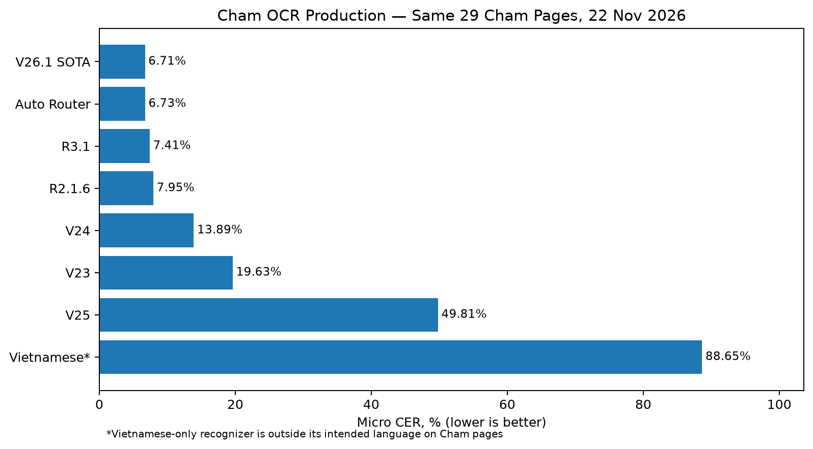
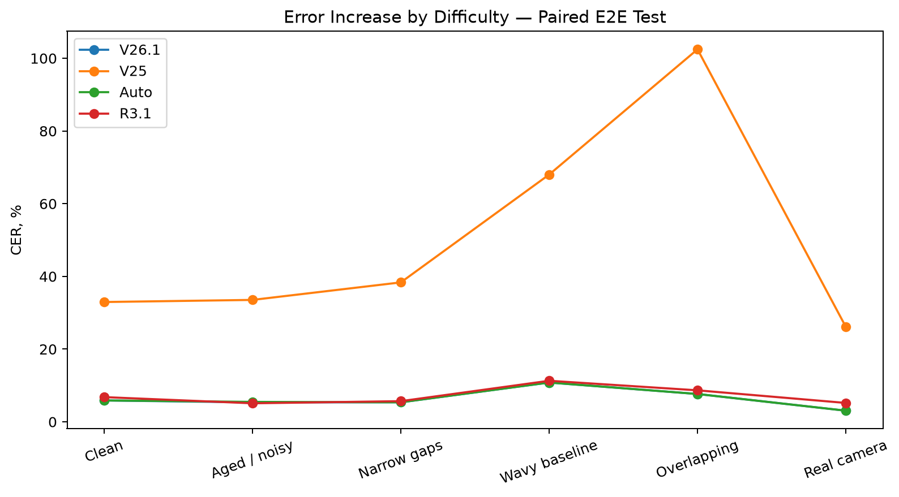
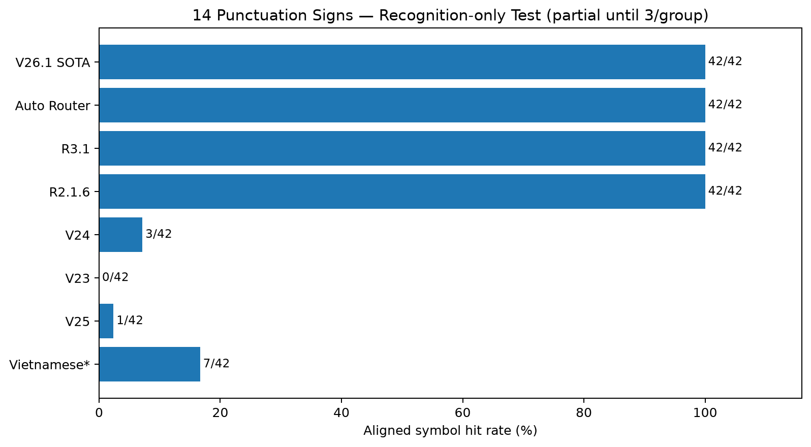
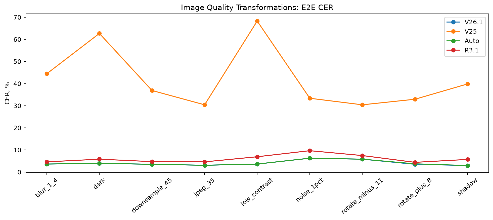

# BÁO CÁO KIỂM THỬ TOÀN DIỆN OCR.CHAM.ASIA — 22/11/2026

## 1. Phạm vi và quy tắc

Đo E2E trên website production bằng POST /ocr; cùng ảnh/nhãn GT, DBNet hybrid và đọc rows. **Cả 8 model/chế độ** được đo trên trọn bộ 30 ảnh cố định. Các nhóm mở rộng có chọn mẫu đại diện và ưu tiên những model chính; số ảnh/model được ghi rõ từng bảng để tránh ngộ nhận là toàn bộ 8 model đã chạy mọi biến thể. Vietnamese là model khác ngôn ngữ, Auto là router không phải checkpoint độc lập.

Micro CER = tổng Levenshtein edits ký tự/tổng ký tự GT trên trang có chữ, Unicode NFC. WER = whitespace-token, chỉ phụ trợ đối với chữ Chăm. Số dòng khớp không chứng minh polygon IoU/precision/recall.

Ảnh test được lưu có SHA256, response có fingerprint checkpoint. Synthetic/biến đổi ảnh có tương quan với ảnh gốc và chưa chứng minh độc lập dữ liệu train. Mẫu real-camera giới hạn, nên không có kết luận tuyệt đối cho tất cả sách/tài liệu thực tế.

Độ trễ được đo trong điều kiện nhiều benchmark đồng thời trên cùng production Space: chỉ có giá trị quan sát thực tế, không phải phép đo tốc độ model trong môi trường cô lập. Muốn so inference tốc độ chuẩn cần chạy từng model tuần tự sau warm-up với concurrency cố định.

## 2. Khối lượng chạy thật

| Suite | Ảnh riêng đã có kết quả | POST /ocr đã ghi | Response lỗi/mismatch |
|---|---:|---:|---:|
| frozen | 30 | 240 | 0 |
| geometry | 15 | 71 | 0 |
| stress | 21 | 84 | 0 |
| vietnamese | 10 | 47 | 0 |

Các suite có số ảnh ít hơn thiết kế là chưa hoàn thành, không được diễn giải là PASS.

## 3. Bảng xếp hạng theo 8 model và bộ dữ liệu

### frozen

| Model | Trang chữ | CER | WER | Đúng số dòng | Đúng toàn trang | Backend P50 | Wall P95 | Lỗi API |
|---|---:|---:|---:|---:|---:|---:|---:|---:|
| V26.1 SOTA | 29 | 6.71% | 24.39% | 96.55% | 0.0% | 5.84s | 15.42s | 0 |
| V25 SOTA | 29 | 49.81% | 101.47% | 93.1% | 0.0% | 2.74s | 8.28s | 0 |
| Auto Router | 29 | 6.73% | 24.39% | 96.55% | 0.0% | 3.0s | 9.12s | 0 |
| R3.1 | 29 | 7.41% | 28.29% | 96.55% | 3.45% | 2.75s | 9.25s | 0 |
| R2.1.6 | 29 | 7.95% | 28.36% | 96.55% | 3.45% | 2.5s | 7.89s | 0 |
| V24 Baseline | 29 | 13.89% | 41.59% | 96.55% | 0.0% | 2.42s | 7.45s | 0 |
| V23 Legacy | 29 | 19.63% | 48.13% | 96.55% | 0.0% | 2.35s | 7.74s | 0 |
| Vietnamese | 29 | 88.65% | 105.66% | 93.1% | 0.0% | 4.97s | 16.86s | 0 |

### geometry

| Model | Trang chữ | CER | WER | Đúng số dòng | Đúng toàn trang | Backend P50 | Wall P95 | Lỗi API |
|---|---:|---:|---:|---:|---:|---:|---:|---:|
| V26.1 SOTA | 15 | 18.47% | 46.33% | 93.33% | 0.0% | 16.76s | 32.98s | 0 |
| V25 SOTA | 15 | 56.45% | 92.96% | 80.0% | 0.0% | 15.77s | 35.97s | 0 |
| Auto Router | 15 | 18.36% | 46.87% | 93.33% | 0.0% | 15.36s | 25.56s | 0 |
| R3.1 | 14 | 21.62% | 54.12% | 92.86% | 0.0% | 15.32s | 30.08s | 0 |
| R2.1.6 | 3 | 39.29% | 100.0% | 100.0% | 0.0% | 12.53s | 15.36s | 0 |
| V24 Baseline | 3 | 40.87% | 80.72% | 66.67% | 0.0% | 11.86s | 15.73s | 0 |
| V23 Legacy | 3 | 43.65% | 97.19% | 100.0% | 0.0% | 10.98s | 15.58s | 0 |
| Vietnamese | 3 | 84.03% | 100.0% | 100.0% | 0.0% | 21.31s | 23.06s | 0 |

### stress

| Model | Trang chữ | CER | WER | Đúng số dòng | Đúng toàn trang | Backend P50 | Wall P95 | Lỗi API |
|---|---:|---:|---:|---:|---:|---:|---:|---:|
| V26.1 SOTA | 18 | 4.04% | 13.93% | 100.0% | 0.0% | 9.98s | 30.08s | 0 |
| V25 SOTA | 18 | 42.14% | 88.83% | 94.44% | 0.0% | 13.06s | 31.7s | 0 |
| Auto Router | 18 | 4.06% | 13.99% | 94.44% | 0.0% | 9.35s | 25.5s | 0 |
| R3.1 | 18 | 5.99% | 21.61% | 100.0% | 0.0% | 9.76s | 23.88s | 0 |
| R2.1.6 | 0 | -% | -% | -% | -% | -s | -s | 0 |
| V24 Baseline | 0 | -% | -% | -% | -% | -s | -s | 0 |
| V23 Legacy | 0 | -% | -% | -% | -% | -s | -s | 0 |
| Vietnamese | 0 | -% | -% | -% | -% | -s | -s | 0 |

### vietnamese

| Model | Trang chữ | CER | WER | Đúng số dòng | Đúng toàn trang | Backend P50 | Wall P95 | Lỗi API |
|---|---:|---:|---:|---:|---:|---:|---:|---:|
| V26.1 SOTA | 10 | 77.87% | 96.38% | 100.0% | 0.0% | 13.53s | 21.8s | 0 |
| V25 SOTA | 10 | 95.92% | 138.46% | 100.0% | 0.0% | 8.91s | 18.05s | 0 |
| Auto Router | 10 | 16.97% | 29.86% | 100.0% | 30.0% | 12.05s | 22.67s | 0 |
| R3.1 | 2 | 91.25% | 131.67% | 100.0% | 0.0% | 20.26s | 18.77s | 0 |
| R2.1.6 | 2 | 96.2% | 103.33% | 100.0% | 0.0% | 6.76s | 8.62s | 0 |
| V24 Baseline | 2 | 84.41% | 100.0% | 100.0% | 0.0% | 11.75s | 7.67s | 0 |
| V23 Legacy | 1 | 78.05% | 100.0% | 100.0% | 0.0% | 5.58s | 7.3s | 0 |
| Vietnamese | 10 | 7.84% | 19.46% | 100.0% | 0.0% | 14.85s | 26.61s | 0 |

**Ghi chú:** Không xếp hạng model tiếng Việt bằng CER chữ Chăm. Các trang song ngữ phải xem riêng theo ngôn ngữ, còn toàn-trang CER có thể bị chi phối bởi tỷ lệ Chăm/Việt.

## 4. CER từ dễ đến khó / điều kiện ảnh

### frozen

| Độ khó/biến thể | V26.1 SOTA | V25 SOTA | Auto Router | R3.1 | R2.1.6 | V24 Baseline | V23 Legacy | Vietnamese |
|---|---:|---:|---:|---:|---:|---:|---:|---:|
| 1 | 5.89% (4) | 32.96% (4) | 5.89% (4) | 6.8% (4) | 6.34% (4) | 14.38% (4) | 21.97% (4) | 90.15% (4) |
| 2 | 5.36% (6) | 33.54% (6) | 5.49% (6) | 5.11% (6) | 5.61% (6) | 13.34% (6) | 21.45% (6) | 89.15% (6) |
| 3 | 5.38% (6) | 38.36% (6) | 5.38% (6) | 5.69% (6) | 6.53% (6) | 13.22% (6) | 21.21% (6) | 93.54% (6) |
| 4 | 10.82% (6) | 68.02% (6) | 10.82% (6) | 11.3% (6) | 12.13% (6) | 18.4% (6) | 23.85% (6) | 84.98% (6) |
| 5 | 7.66% (6) | 102.46% (6) | 7.66% (6) | 8.67% (6) | 9.39% (6) | 15.17% (6) | 21.68% (6) | 86.42% (6) |
| 6 | 3.07% (1) | 26.12% (1) | 3.07% (1) | 5.2% (1) | 5.67% (1) | 6.15% (1) | 4.14% (1) | 87.23% (1) |

### geometry

| Độ khó/biến thể | V26.1 SOTA | V25 SOTA | Auto Router | R3.1 | R2.1.6 | V24 Baseline | V23 Legacy | Vietnamese |
|---|---:|---:|---:|---:|---:|---:|---:|---:|
| control | 18.73% (3) | 62.54% (3) | 19.27% (3) | 23.39% (3) | -% (0) | -% (0) | -% (0) | -% (0) |
| corner_curl | 18.29% (3) | 59.14% (3) | 18.29% (3) | 21.94% (3) | -% (0) | -% (0) | -% (0) | -% (0) |
| mixed_fonts | 19.27% (3) | 31.32% (3) | 19.62% (3) | 20.69% (3) | -% (0) | -% (0) | -% (0) | -% (0) |
| rotation | 18.13% (6) | 61.62% (6) | 17.45% (6) | 20.78% (5) | 39.29% (3) | 40.87% (3) | 43.65% (3) | 84.03% (3) |

### stress

| Độ khó/biến thể | V26.1 SOTA | V25 SOTA | Auto Router | R3.1 | R2.1.6 | V24 Baseline | V23 Legacy | Vietnamese |
|---|---:|---:|---:|---:|---:|---:|---:|---:|
| stress_blur_1_4 | 3.62% (2) | 44.46% (2) | 3.62% (2) | 4.61% (2) | -% (0) | -% (0) | -% (0) | -% (0) |
| stress_dark | 3.95% (2) | 62.68% (2) | 3.95% (2) | 5.82% (2) | -% (0) | -% (0) | -% (0) | -% (0) |
| stress_downsample_45 | 3.51% (2) | 36.88% (2) | 3.51% (2) | 4.72% (2) | -% (0) | -% (0) | -% (0) | -% (0) |
| stress_jpeg_35 | 3.07% (2) | 30.41% (2) | 3.07% (2) | 4.61% (2) | -% (0) | -% (0) | -% (0) | -% (0) |
| stress_low_contrast | 3.62% (2) | 68.28% (2) | 3.62% (2) | 6.92% (2) | -% (0) | -% (0) | -% (0) | -% (0) |
| stress_noise_1pct | 6.26% (2) | 33.37% (2) | 6.26% (2) | 9.66% (2) | -% (0) | -% (0) | -% (0) | -% (0) |
| stress_rotate_minus_11 | 5.82% (2) | 30.41% (2) | 5.82% (2) | 7.46% (2) | -% (0) | -% (0) | -% (0) | -% (0) |
| stress_rotate_plus_8 | 3.51% (2) | 32.93% (2) | 3.73% (2) | 4.39% (2) | -% (0) | -% (0) | -% (0) | -% (0) |
| stress_shadow | 2.96% (2) | 39.85% (2) | 2.96% (2) | 5.71% (2) | -% (0) | -% (0) | -% (0) | -% (0) |

### vietnamese

| Độ khó/biến thể | V26.1 SOTA | V25 SOTA | Auto Router | R3.1 | R2.1.6 | V24 Baseline | V23 Legacy | Vietnamese |
|---|---:|---:|---:|---:|---:|---:|---:|---:|
| mixed_vi_cham | 62.44% (4) | 96.95% (4) | 2.03% (4) | -% (0) | -% (0) | -% (0) | -% (0) | 24.37% (4) |
| vi_only | 82.02% (6) | 95.64% (6) | 20.98% (6) | 91.25% (2) | 96.2% (2) | 84.41% (2) | 78.05% (1) | 3.41% (6) |

## 5. Thống kê so sánh từng ảnh ghép cặp (trùng SHA256)

CER đối thủ − V26.1: dương nghĩa V26.1 tốt hơn. CI95 bootstrap mẫu theo ảnh 2.500 lần; ảnh biến dạng cùng nguồn không độc lập nên khoảng tin cậy có thể lạc quan.

### frozen

| Đối chứng | Ảnh | V26 thắng | Hòa | V26 thua | Δ CER điểm % | 95% CI |
|---|---:|---:|---:|---:|---:|---:|
| V25 SOTA | 29 | 29 | 0 | 0 | 43.1 | 33.67 → 56.08 |
| Auto Router | 29 | 1 | 28 | 0 | 0.02 | 0.0 → 0.06 |
| R3.1 | 29 | 15 | 8 | 6 | 0.7 | 0.16 → 1.2 |
| R2.1.6 | 29 | 19 | 5 | 5 | 1.24 | 0.61 → 1.8 |
| V24 Baseline | 29 | 28 | 1 | 0 | 7.18 | 5.82 → 8.62 |
| V23 Legacy | 29 | 29 | 0 | 0 | 12.92 | 9.48 → 16.09 |
| Vietnamese | 29 | 29 | 0 | 0 | 81.94 | 77.83 → 85.37 |

### geometry

| Đối chứng | Ảnh | V26 thắng | Hòa | V26 thua | Δ CER điểm % | 95% CI |
|---|---:|---:|---:|---:|---:|---:|
| V25 SOTA | 15 | 15 | 0 | 0 | 37.98 | 26.16 → 49.54 |
| Auto Router | 15 | 7 | 4 | 4 | -0.11 | -0.65 → 0.31 |
| R3.1 | 14 | 12 | 0 | 2 | 2.82 | 1.52 → 4.26 |
| R2.1.6 | 3 | 3 | 0 | 0 | 8.73 | 7.44 → 10.42 |
| V24 Baseline | 3 | 3 | 0 | 0 | 10.32 | 7.44 → 14.29 |
| V23 Legacy | 3 | 3 | 0 | 0 | 13.1 | 11.61 → 16.07 |
| Vietnamese | 3 | 3 | 0 | 0 | 53.47 | 47.92 → 58.33 |

### stress

| Đối chứng | Ảnh | V26 thắng | Hòa | V26 thua | Δ CER điểm % | 95% CI |
|---|---:|---:|---:|---:|---:|---:|
| V25 SOTA | 18 | 18 | 0 | 0 | 38.1 | 30.13 → 49.3 |
| Auto Router | 18 | 1 | 17 | 0 | 0.02 | 0.0 → 0.1 |
| R3.1 | 18 | 11 | 3 | 4 | 1.95 | 1.3 → 2.57 |

### vietnamese

| Đối chứng | Ảnh | V26 thắng | Hòa | V26 thua | Δ CER điểm % | 95% CI |
|---|---:|---:|---:|---:|---:|---:|
| V25 SOTA | 10 | 10 | 0 | 0 | 18.05 | 11.7 → 26.75 |
| Auto Router | 10 | 0 | 0 | 10 | -60.9 | -73.46 → -47.62 |
| R3.1 | 2 | 2 | 0 | 0 | 8.37 | 7.14 → 9.76 |
| R2.1.6 | 2 | 2 | 0 | 0 | 13.31 | 12.2 → 14.29 |
| V24 Baseline | 2 | 2 | 0 | 0 | 1.52 | 1.43 → 1.63 |
| V23 Legacy | 1 | 0 | 0 | 1 | -2.44 | -2.44 → -2.44 |
| Vietnamese | 10 | 0 | 0 | 10 | -70.03 | -77.69 → -58.08 |

## 6. Hồi quy phiên bản cũ 20/11 vs phiên bản mới 22/11

Trùng ảnh và SHA256: 29 trang có chữ; R4 cũ fingerprint 85525b0ca091acaf CER 7.63%; V26.1 fingerprint 1deee5f5ff351070 CER 6.71%; thay đổi -0.92 điểm %.

Kết quả là E2E ở 2 ngày đo khác nhau, chịu ảnh hưởng của cả backend/detector/normalizer, không chứng minh nguyên nhân chỉ do thay checkpoint.

## 7. Dấu câu 14 loại và dấu gạch nối 7 ngữ cảnh

| Model | Crop | CER | Full line exact | Đúng symbol | Đúng số dấu - | API errors |
|---|---:|---:|---:|---:|---:|---:|
| V26.1 SOTA | 63 | 0.75% | 93.65% | 42/42 | 21/21 | 0 |
| V25 SOTA | 63 | 43.18% | 0.0% | 1/42 | 0/21 | 0 |
| Auto Router | 63 | 0.6% | 93.65% | 42/42 | 21/21 | 0 |
| R3.1 | 63 | 1.2% | 87.3% | 42/42 | 19/21 | 0 |
| R2.1.6 | 43 | 1.41% | 83.72% | 42/42 | 1/1 | 0 |
| V24 Baseline | 42 | 18.89% | 0.0% | 3/42 | 0/0 | 0 |
| V23 Legacy | 42 | 26.9% | 0.0% | 0/42 | 0/0 | 0 |
| Vietnamese | 42 | 118.69% | 0.0% | 7/42 | 0/0 | 0 |

Symbol được chấm bằng alignment Levenshtein tại vị trí GT; hyphen chỉ chấm số lượng, không xác nhận vị trí. Đây là crop đã được tách sẵn, không đo lỗi detector.

### Từng ký hiệu
| Ký hiệu | V26.1 SOTA | V25 SOTA | Auto Router | R3.1 | R2.1.6 | V24 Baseline | V23 Legacy | Vietnamese |
|---|---:|---:|---:|---:|---:|---:|---:|---:|
| ! | 3/3 | 0/3 | 3/3 | 3/3 | 3/3 | 0/3 | 0/3 | 1/3 |
| # | 3/3 | 0/3 | 3/3 | 3/3 | 3/3 | 0/3 | 0/3 | 0/3 |
| & | 3/3 | 0/3 | 3/3 | 3/3 | 3/3 | 0/3 | 0/3 | 1/3 |
| * | 3/3 | 0/3 | 3/3 | 3/3 | 3/3 | 0/3 | 0/3 | 0/3 |
| / | 3/3 | 0/3 | 3/3 | 3/3 | 3/3 | 0/3 | 0/3 | 2/3 |
| < | 3/3 | 0/3 | 3/3 | 3/3 | 3/3 | 0/3 | 0/3 | 0/3 |
| > | 3/3 | 0/3 | 3/3 | 3/3 | 3/3 | 0/3 | 0/3 | 0/3 |
| ? | 3/3 | 1/3 | 3/3 | 3/3 | 3/3 | 0/3 | 0/3 | 3/3 |
| [ | 3/3 | 0/3 | 3/3 | 3/3 | 3/3 | 3/3 | 0/3 | 0/3 |
| BACKSLASH | 3/3 | 0/3 | 3/3 | 3/3 | 3/3 | 0/3 | 0/3 | 0/3 |
| ] | 3/3 | 0/3 | 3/3 | 3/3 | 3/3 | 0/3 | 0/3 | 0/3 |
| _ | 3/3 | 0/3 | 3/3 | 3/3 | 3/3 | 0/3 | 0/3 | 0/3 |
| { | 3/3 | 0/3 | 3/3 | 3/3 | 3/3 | 0/3 | 0/3 | 0/3 |
| } | 3/3 | 0/3 | 3/3 | 3/3 | 3/3 | 0/3 | 0/3 | 0/3 |

## 8. Top lỗi nặng nhất của model mặc định

### frozen
| Ảnh | Độ khó | CER | Dòng OCR/GT | Edit |
|---|---:|---:|---:|---:|
| synthetic_142 | 4 | 23.84% | 7/8 | 87 |
| synthetic_134 | 4 | 10.37% | 3/3 | 14 |
| synthetic_089 | 3 | 10.11% | 2/2 | 9 |
| synthetic_196 | 5 | 9.82% | 3/3 | 16 |
| synthetic_049 | 2 | 9.23% | 2/2 | 6 |
| synthetic_147 | 4 | 9.23% | 2/2 | 6 |
| synthetic_180 | 5 | 8.48% | 5/5 | 19 |
| synthetic_034 | 1 | 8.23% | 5/5 | 20 |
| synthetic_198 | 5 | 7.45% | 2/2 | 7 |
| synthetic_087 | 3 | 7.32% | 3/3 | 6 |

### geometry
| Ảnh | Độ khó | CER | Dòng OCR/GT | Edit |
|---|---:|---:|---:|---:|
| base_ood_folio_07_campa | control | 35.36% | 15/15 | 128 |
| rot_ood_agal_01_panduranga_+08 | rotation | 35.12% | 14/14 | 118 |
| rot_ood_agal_01_panduranga_-06 | rotation | 31.25% | 14/14 | 105 |
| curl_ood_folio_07_campa_tl_18 | corner_curl | 29.83% | 15/15 | 108 |
| curl_ood_agal_02_panrang_br_18 | corner_curl | 27.27% | 14/14 | 93 |
| rot_ood_agal_01_panduranga_-12 | rotation | 25.30% | 14/14 | 85 |
| mix_within_04 | mixed_fonts | 23.60% | 6/6 | 76 |
| base_ood_agal_01_panduranga | control | 22.92% | 14/14 | 77 |
| mix_06_fonts | mixed_fonts | 19.05% | 12/12 | 60 |
| rot_ood_agal_04_thrah_-09 | rotation | 14.50% | 15/15 | 59 |

### stress
| Ảnh | Độ khó | CER | Dòng OCR/GT | Edit |
|---|---:|---:|---:|---:|
| stress_synthetic_167_rotate_minus_11 | stress_rotate_minus_11 | 40.00% | 2/2 | 26 |
| stress_synthetic_167_blur_1_4 | stress_blur_1_4 | 9.23% | 2/2 | 6 |
| stress_synthetic_167_noise_1pct | stress_noise_1pct | 9.23% | 2/2 | 6 |
| stress_synthetic_167_downsample_45 | stress_downsample_45 | 6.15% | 2/2 | 4 |
| stress_synthetic_167_jpeg_35 | stress_jpeg_35 | 6.15% | 2/2 | 4 |
| stress_synthetic_167_low_contrast | stress_low_contrast | 6.15% | 2/2 | 4 |
| stress_synthetic_167_shadow | stress_shadow | 6.15% | 2/2 | 4 |
| stress_real_harum_palei_01_noise_1pct | stress_noise_1pct | 6.03% | 25/25 | 51 |
| stress_synthetic_167_dark | stress_dark | 4.62% | 2/2 | 3 |
| stress_synthetic_167_rotate_plus_8 | stress_rotate_plus_8 | 4.62% | 2/2 | 3 |

### vietnamese
| Ảnh | Độ khó | CER | Dòng OCR/GT | Edit |
|---|---:|---:|---:|---:|
| vietnamese_04 | vi_only | 85.71% | 3/3 | 120 |
| vietnamese_01 | vi_only | 85.00% | 3/3 | 119 |
| vietnamese_05 | vi_only | 80.77% | 3/3 | 84 |
| vietnamese_00 | vi_only | 80.49% | 3/3 | 99 |
| vietnamese_03 | vi_only | 79.67% | 3/3 | 98 |
| vietnamese_02 | vi_only | 78.85% | 3/3 | 82 |
| mixed_vi_cham_00 | mixed_vi_cham | 66.67% | 2/2 | 30 |
| mixed_vi_cham_01 | mixed_vi_cham | 64.52% | 2/2 | 40 |
| mixed_vi_cham_03 | mixed_vi_cham | 60.00% | 2/2 | 30 |
| mixed_vi_cham_02 | mixed_vi_cham | 57.50% | 2/2 | 23 |

## 9. Lỗi ký tự trên bộ cố định

Nhóm: Cham vowel / diacritic=107, Cham coda=65, Spacing / linebreak=58, ASCII punctuation=55, Cham punctuation=49, Cham base consonant / vowel=36, Other=19, Cham digit=8, Cham medial=4

| Operation | GT | OCR | Số lượt |
|---|---:|---:|---:|
| D | ꩝ | ∅ | 37 |
| I | ∅ | SPACE | 28 |
| D | ꨮ | ∅ | 24 |
| D | SPACE | ∅ | 24 |
| S | : | ; | 20 |
| D | ꩌ | ∅ | 16 |
| D | ? | ∅ | 14 |
| D | ꩃ | ∅ | 12 |
| S | – | - | 11 |
| S | ꨮ | ꨩ | 10 |
| I | ∅ | ꩌ | 9 |
| D | ꩀ | ∅ | 7 |
| D | – | ∅ | 7 |
| D | ꨯ | ∅ | 7 |
| S | ꨩ | ꩌ | 6 |
| S | ꨁ | ꨄ | 6 |
| S | ꨩ | ꩃ | 6 |
| I | ∅ | ꨱ | 6 |
| S | ꨮ | ꨱ | 6 |
| S | ꨰ | ꨘ | 4 |
| S | ꨘ | ꨰ | 4 |
| S | ) | SPACE | 4 |

## 10. Ảnh không chữ / false positives

| Model | Ảnh âm tính | Đúng (0 dòng) | Nhận nhầm (hơn 0) | API lỗi |
|---|---:|---:|---:|---:|
| V26.1 SOTA | 4 | 4 | 0 | 0 |
| V25 SOTA | 4 | 4 | 0 | 0 |
| Auto Router | 4 | 4 | 0 | 0 |
| R3.1 | 4 | 4 | 0 | 0 |
| R2.1.6 | 1 | 1 | 0 | 0 |
| V24 Baseline | 1 | 1 | 0 | 0 |
| V23 Legacy | 1 | 1 | 0 | 0 |
| Vietnamese | 1 | 1 | 0 | 0 |

## 11. Kiểm thử Chrome, nhập PDF và xuất định dạng

Playwright Chrome thực: transcribe PASS, export_txt PASS, export_md PASS, export_json PASS, export_xml PASS, export_zip PASS, pdf_import PASS.
Browser JS errors: 0; failed browser requests: 0.

Sau khi export: TXT gồm 6 dòng, 170 ký tự Chăm; PAGE-XML hợp lệ có 6 TextLine; ZIP gồm 12 entries, kiểm CRC=None.

## 12. Kiểm thử HTTP và dữ liệu sai

| Trường hợp | HTTP | Giây |
|---|---:|---:|
| GET /health | 200 | 0.58 |
| GET /api/models | 200 | 0.59 |
| GET /api/samples | 200 | 0.95 |
| GET /static/js/studio.js | 200 | 1.11 |
| format_PNG | 200 | 4.67 |
| format_JPEG | 200 | 4.0 |
| format_WEBP | 200 | 3.31 |
| format_GIF | 400 | 0.78 |
| missing_image | 502 | 0.86 |
| corrupt_base64 | 400 | 0.94 |
| invalid_model | 400 | 0.53 |
| empty_image | 400 | 3.91 |
| invalid_segmentation | 200 | 4.31 |
| invalid_reading_order | 200 | 5.41 |
| invalid_bbox_zero | 200 | 3.92 |
| invalid_bbox_negative | 200 | 4.22 |

**P0/P1 phát hiện thật:** Model không tồn tại nonexistent_model_2026 vẫn HTTP 200; metadata nhận tên model được yêu cầu, nhưng model_dir=data/output/rec_cham_inference_v23, SHA=70dac0b0d59fc995 chính là V23 Legacy. Nguy cơ benchmark/model provenance giả.

## 13. Dự đoán nhầm chữ Latin trên văn bản Chăm

Nhãn chuẩn 29 trang hoàn toàn không chứa chữ cái Latin. Đếm theo Unicode Name LATIN của ký tự đầu ra OCR, không tính chữ số/ký hiệu.

| Model | Trang | Chữ Latin do OCR tạo | Tỷ lệ Latin trong text OCR | Trang xuất hiện Latin |
|---|---:|---:|---:|---:|
| V26.1 SOTA | 29 | 0 | 0.0% | 0 |
| V25 SOTA | 29 | 280 | 4.1% | 21 |
| Auto Router | 29 | 0 | 0.0% | 0 |
| R3.1 | 29 | 0 | 0.0% | 0 |
| R2.1.6 | 29 | 0 | 0.0% | 0 |
| V24 Baseline | 29 | 0 | 0.0% | 0 |
| V23 Legacy | 29 | 0 | 0.0% | 0 |
| Vietnamese | 29 | 2379 | 40.29% | 29 |

**Kiểm tra giả thuyết sai thứ tự từ điển trên bản export local:** V25 SOTA: 162 token, thứ tự YAML so với file từ điển TRÙNG, V26.1 SOTA: 114 token, thứ tự YAML so với file từ điển TRÙNG, R3.1: 114 token, thứ tự YAML so với file từ điển TRÙNG. Việc trùng thứ tự ở bản local giúp loại trừ lỗi đơn giản này, nhưng chưa kiểm tra trực tiếp nội dung dictionary được máy chủ dùng khi deploy.

## 14. Hiệu chỉnh confidence và rủi ro tin sai

Confidence trung bình theo trang là thống kê mô tả, không tương đương độ chính xác ký tự; các model có nhiệt độ hiệu chỉnh khác nhau.

| Model | Confidence TB | Pearson (confidence,CER) | Trang conf >=90% nhưng CER >=20% |
|---|---:|---:|---:|
| V26.1 SOTA | 0.959 | -0.331 | 1 |
| V25 SOTA | 0.656 | -0.946 | 0 |
| Auto Router | 0.959 | -0.349 | 1 |
| R3.1 | 0.958 | -0.337 | 1 |
| R2.1.6 | 0.948 | -0.617 | 1 |
| V24 Baseline | 0.909 | -0.428 | 1 |
| V23 Legacy | 0.923 | -0.574 | 16 |
| Vietnamese | 0.629 | 0.284 | 0 |

## 15. Ca lỗi có thể tái hiện bằng OCR crop

Ví dụ crop trực tiếp: không phụ thuộc DBNet tách dòng. Xem JSON song song đầy đủ trong v25_vs_r4_repro_examples.json.
| ID | R4 CER% | V25 CER% | GT | R4 | V25 |
|---|---:|---:|---:|---:|---:|
| hyphen_26 | 0.0 | 100.0 | 7-8 | 7-8 | ꩑ꨪt |
| hyphen_21 | 0.0 | 100.0 | 1-2 | 1-2 | ꩑ |
| hyphen_28 | 0.0 | 100.0 | 89-90 | 89-90 | ꩕꩕ |
| hyphen_32 | 0.0 | 100.0 | 1975-1986 | 1975-1986 | ꩑ꨆꨰ: ꩆꩉꩆ |

## 16. Chữ số Chăm U+AA50..U+AA59 (nhận dạng crop)

Ba font Noto Sans Cham thuộc các kiểu nét Light/Medium/SemiBold, mỗi font chứa các chuỗi 10 số Chăm và mẫu ngày/năm.

| Model | Crops | CER số Chăm | Đúng cả crop | API errors |
|---|---:|---:|---:|---:|
| V26.1 SOTA | 12 | 14.0% | 33.33% | 0 |
| V25 SOTA | 12 | 91.33% | 0.0% | 0 |
| Auto Router | 12 | 14.0% | 33.33% | 0 |
| R3.1 | 12 | 11.33% | 33.33% | 0 |

## 17. Cấu hình phát hiện dòng và thứ tự đọc

Ba cấu hình kiểm thử độc lập: valley/rows, adaptive/rows, dbnet/auto trên ba trang. Đây là mean per-page CER cho thăm dò, không tương đương micro CER ở phần chính.

| Method | V26.1 SOTA | V25 SOTA | Auto Router | R3.1 |
|---|---:|---:|---:|---:|
| valley | 14.85% | 38.1% | 15.49% | 15.01% |
| adaptive | 33.5% | 51.39% | 33.5% | 32.81% |
| dbnet | 6.55% | 29.39% | 6.71% | 8.21% |

## 18. Biểu đồ trực quan

## 19. Đánh giá và khuyến nghị ưu tiên

1. **P0/High — Model provenance**: validate model_id từ allowlist; không tồn tại phải HTTP 400; actual_model và fingerprint phải xuất từ checkpoint thực, không echo ID người dùng.
2. **P1/High — API**: thiếu image trả HTTP502 đã tái hiện; thay bằng HTTP400 JSON. Invalid method/reading_order nhận HTTP200; input validation và thông báo fallback cần rõ ràng.
3. **P1/High — V25**: kiểm tra sự khác nhau giữa validation CER trong quá trình train và E2E CER production: dữ liệu train/GT, thứ tự Unicode, dictionary/token, preprocessing, width W480, detector crop, nguy cơ domain shift.
4. **P1 — Chỉ đổi model mặc định sau frozen real-world gate**: micro CER trên nhiều bản thảo thật độc lập, đánh giá theo nguồn tài liệu, có CI theo tài liệu. Hiện số trang gốc camera chưa đủ.
5. **P1 — Diacritics & ký hiệu**: khai thác top confusion, hard-mine các dấu Chăm, phụ âm cuối, dấu nối, các tổ hợp Unicode cluster; giải thích lỗi theo dấu/cặp ký tự.
6. **P1 — Line detection**: cần GT polygon và F1 IoU, kiểm tra cắt dòng, nối dòng, hai cột, đảo chiều đọc, cong giấy một góc.
7. **P2 — Auto router/đa ngữ**: gán nhãn ngôn ngữ theo dòng, đo route accuracy và riêng CER từng chữ; không xếp hạng Vietnamese theo Cham-only CER. API Auto hiện không xuất model/ngôn ngữ được chọn cho mỗi dòng, nên nên bổ sung selected_recognizer và router confidence để audit.
8. **P2 — Regression vận hành**: kiểm tra PDF 100 trang, memory usage, mobile Safari/Firefox, mạng mất kết nối, video/camera, file nặng, file MIME sai, bảo toàn sửa thủ công.
9. **P2 — Bổ sung ảnh thật**: thu ≥100 trang từ nhiều nguồn, chụp điện thoại, chữ viết tay, scan giấy ngả vàng, dấu phủ mực, độ sáng/góc khác nhau, split hold-out theo tài liệu tránh leakage.

## 20. Giới hạn và tái lập

Các bộ ảnh mới thuộc dạng ảnh tạo từ nguồn cũ (biến dạng và ghép có GT xác định); không chứng minh đã bao phủ mọi tình huống thực tế. Không test trực tiếp trên iOS/Android hoặc đánh giá hình học polygon với nhãn người gán.
Nguyên tắc: chỉ tính các request JSONL đã ghi; model trực tiếp phải trả actual version khớp tên; router được ghi như router, không coi là checkpoint mới.
Dữ liệu: REPORTS/live_v26_audit_2026_11_22/{frozen,geometry,stress,vietnamese,crops,pipeline}/results.jsonl, summary.json; nguồn GT manifest có SHA.
Script: scripts/benchmark_all_live_v26.py, benchmark_live_v26_crops.py, benchmark_live_v26_pipeline.py, generate_v26_audit_cases.py, ui_export_pdf_e2e_v26.js.
Không thay đổi production, không train model, không git push.

